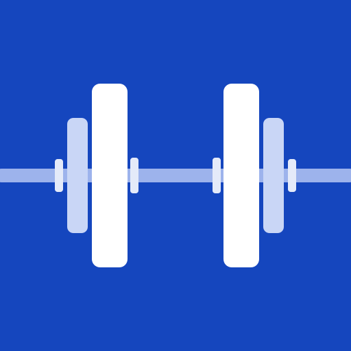
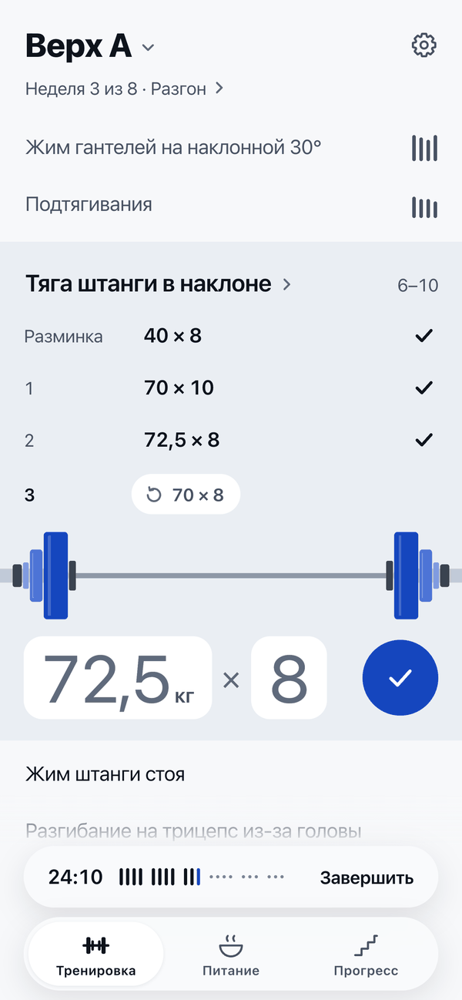
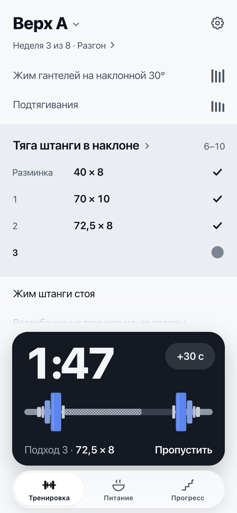
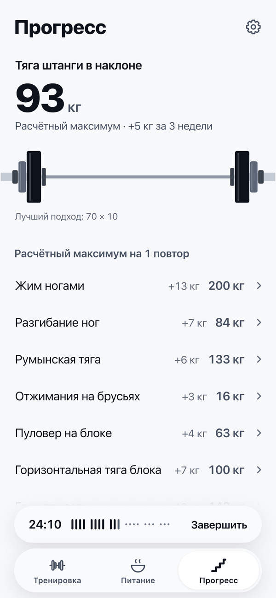
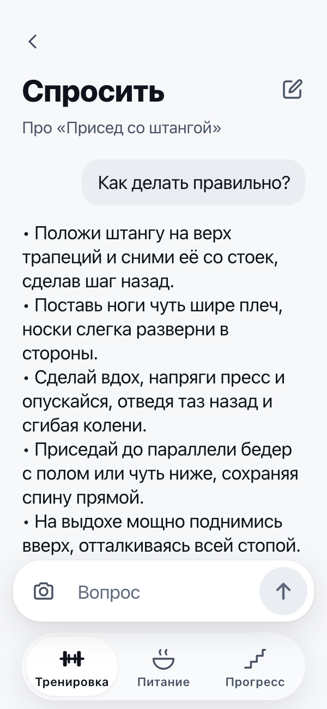

<div align="center">



# FORGE

**A workout program and meal plan made for you, then a log for the gym.**

English · [Русский](README.ru.md)

[Open the app](https://feadal.github.io/forge/) (the interface is in Russian)

   

</div>

## What it does

A questionnaire of 9 short screens builds an 8-week program. The app picks a split for you (full body, upper/lower, push/pull/legs or a body-part split) or uses the one you choose. Volume, phases and exercises follow your experience, goal, training days, equipment and injuries.

In the gym a set takes one tap: weight and reps are already filled in from your previous set or from last week. To change them there is a custom keypad with 2.5 kg steps. The app also tells warm-up, drop and to-failure sets apart.

The current set is drawn. At 72.5 kg you see what to load: 20, 5 and 1.25 per side. Dumbbells, cable stacks and weighted pull-ups get their own drawings.

During rest the knurling on the drawn bar runs down with the time. The timer counts from a timestamp, so a locked screen does not reset it. The screen stays awake during a workout, and a chime marks the end of rest.

After a workout the app shows your records. The Progress tab shows the estimated one-rep max of the exercises in your program; for pull-ups and dips it includes your body weight.

Nutrition covers calories, protein, fat, carbs and a daily menu. The menu respects 16 restrictions, from allergies and intolerances to vegetarian diets.

If you have an injury, risky exercises stay out of the program. If you report warning symptoms in the questionnaire, the app sends you to a doctor first.

The Ask screen answers questions about technique, the program and food. Send it a photo of a meal and it estimates the portion, calories and macros. The estimate is rough, and the app says so.

## Install

Open [feadal.github.io/forge](https://feadal.github.io/forge/) and add it to your home screen.

- iPhone: in Safari tap Share, then Add to Home Screen.
- Android: in Chrome open the menu and tap Install app.

The first launch needs an internet connection. After that the app works offline, except for the Ask screen.

## Privacy

The app has no accounts. Your profile, program and workout history stay on your phone, in `localStorage`.

Two things leave the phone, both through a small proxy (`worker/`):

- On the Ask screen, your question and the photo if you attach one go to Google Gemini, or to Cloudflare Workers AI when Gemini does not answer. Also sent: your goal, the exercise you asked about, and the last few messages of the current chat, so follow-up questions make sense. The app asks before the first question, and you can turn the assistant off in Settings.
- Once a day, when online, the app sends a random install number and whether a program has been built, so the owner can count how many people use it. On the day you build a program it sends once more. The proxy keeps the number, the days the app was opened, and that one flag. Nothing else goes with it: no weight, workouts, questions or device details. The number is made on the phone and is replaced when you delete all data. The phone also keeps it in a cookie: when you add the app to the Home Screen, iPhone copies cookies but no other data, so Safari and the Home Screen app count as one install. Like any cookie of the site, it goes to GitHub Pages with requests for the app's files.

## Evidence behind the rules

- 10 to 20 hard sets per muscle per week, with each muscle trained twice a week: Schoenfeld's meta-analyses.
- Exercises loaded at long muscle lengths come first: Maeo, 2023.
- Protein at 1.6 to 2.2 g per kg of body weight: the ISSN position stand and Morton's 2018 meta-analysis.
- In trained lifters, stopping 1 or 2 reps short of failure builds as much muscle as going to failure.
- On a cut, heavy compound work keeps muscle in a deficit.
- Exercise swaps for injuries follow clinical guidelines.

## Development

```
index.html                the built app, a single file
sw.js                     service worker, offline cache
manifest.webmanifest      PWA manifest
src/
  engine.js               training: splits, volume, exercise selection, injuries
  nutrition.js            nutrition: calories, macros, menu, restrictions
  ui.js                   interface and log
  style.css               styles
  index.template.html     page template
  build.sh                builds index.html
worker/                   proxy for the Ask screen (Cloudflare Worker)
```

Build with `bash src/build.sh`. It needs only `bash` and `python3`; there is nothing to install.

### Proxy

The Worker in `worker/` serves the Ask screen, the daily install ping (`/ping`) and the owner's stats page (`/stats`). The Gemini key lives in Cloudflare secrets, never in the repository or the app. To deploy your own proxy:

```bash
cd worker
npx wrangler login
npx wrangler secret put GEMINI_API_KEY
npx wrangler deploy
```

Then set `ASK_URL` in `src/ui.js` to the Worker address and rebuild. Allowed origins, the models (tried in order when one is busy) and the rate limits are in `worker/wrangler.toml`. Models whose names start with `@cf/` run on Cloudflare Workers AI through the `AI` binding and need no extra key. With `ASK_URL` empty the Ask screen and the install count are off.

The install count needs a D1 database and a password for the stats page:

```bash
npx wrangler d1 create forge-stats
npx wrangler d1 execute forge-stats --remote --file schema.sql
npx wrangler secret put STATS_KEY
```

Put the database id into `worker/wrangler.toml` and deploy again. The counts are at `/stats` on the Worker address, behind that password.

## Disclaimer

FORGE helps you plan. It does not replace a doctor, a dietitian or a coach. If you have a condition or an injury, or take medication, check the program and the meal plan with a specialist.
